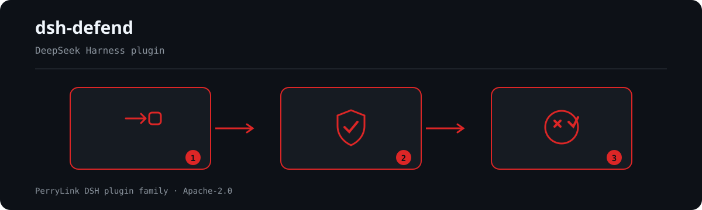

<div align="center">

# 🛡️ dsh-defend
- **1024 store channel**: `npm i -g dsh1024` once, then `dsh1024 plugin --profile web add dsh-defend` (counts toward the [deepseek1024.com](https://deepseek1024.com) install ranking).
[](https://gitee.com/perrylink/dsh-defend)
[](https://dshfind.com/plugins/PerryLink/dsh-defend?ref=badge)
[](https://api.securityscorecards.dev/projects/github.com/PerryLink/dsh-defend)

**Prompt-injection, jailbreak, and secret-leak defense for DeepSeek Harness.**

*Rules decide the known. Interception decides the rest — and everything is audited.*

[](LICENSE)
[](https://github.com/topics/dsh-plugin)
[](https://github.com/PerryLink/dsh-plugin-doctor#verified-徽章)
[](https://dsh.market/)
[](#)
[](https://github.com/PerryLink/dsh-defend/actions)
[](https://github.com/PerryLink/dsh-defend/releases)
[](https://www.npmjs.com/package/dsh-defend)
[](https://www.npmjs.com/package/dsh-defend)

[English](README.md) · [简体中文](README-zh.md) · [Español](README-es.md) · [Português](README-pt.md) · [हिन्दी](README-hi.md)

```sh
dsh plugin --profile <name> add dsh-defend
```


</div>

---

**📖 Ecosystem knowledge base** — measured data, not marketing: [plugin development guide · plugin-selection data · maintenance criteria](https://perrylink.github.io/dsh-plugin-guide/).

<!-- star-cta -->
## Install & uninstall

- **git channel** (latest `main`): `dsh plugin --profile web add github:PerryLink/dsh-defend` — the `prepare` script builds with production dependencies only.
- **npm channel** (published releases): `dsh plugin --profile web add dsh-defend`.
- **tarball channel**: `pnpm pack` in this repo, then `dsh plugin --profile web add ./dsh-defend-<version>.tgz`.
- **uninstall**: `dsh plugin --profile web remove dsh-defend` (or remove the row from the profile patch).

## ⭐ 如果它帮到了你

这个插件是 [DSH 插件家族](https://github.com/PerryLink)的一员（95 个，全部 Apache-2.0）。如果你在用，**给个 star** —— 它不会解锁任何功能，但会让下一个人在搜索里更容易找到它。

*English:* part of a 95 plugin family for DeepSeek Harness. If it is useful, **a star helps the next person find it** — nothing is gated behind it.


## What is dsh-defend?

Prompt-injection, jailbreak, and secret-leak defense for DeepSeek Harness.

Rules decide the known. Interception decides the rest — and everything is audited.



*Workflow overview: request → policy / review → verdict. The examples below use the real command surface.*


## Maintenance status: 🧊 FROZEN

> **Frozen on 2026-10-05. No new features.** This package still works, and it is not retired — but it no longer receives feature work. Only a genuine breakage will be fixed.

Maintainers treat this capability as one where **better-adopted alternatives now exist**, so effort has moved elsewhere. The comparison below was measured on 2026-10-05 and is recorded so nobody has to redo it.

| | package | weekly downloads |
|---|---|---|
| **this package** | `dsh-defend` | 937 |
| better-adopted alternative | [`cc-safety-net`](https://github.com/kenryu42/cc-safety-net) | **13,087** |

**Why the alternative leads.** `cc-safety-net` provides blocks destructive commands and secret-file access as a coding-agent CLI hook.

**Compatibility.** declares no dsh peers, so the compatibility guard never blocks it.

**What this package still does that the alternatives do not.** this package's differentiators are the Aho-Corasick pattern engine ported from the prompt-injection / jailbreak / secret-leaker asset sets, three-way allow/ask/block interception on user messages, tool arguments AND tool results, and sanitized defend/* session audit events. The rival above is narrower (destructive commands and secret files) but is adopted an order of magnitude more widely.

👉 **For new work, prefer dsh-defend is still the broader detector; cc-safety-net is the far better-adopted alternative for the destructive-command gate specifically.** Existing installs keep working unchanged; nothing is being removed.

*Full evidence, including the host-version compatibility matrix: `dsh-plugin-supersession-review-20261005.md`.*

## Comparison


105 samples (75 positive / 30 negative) · from benchmark/RESULTS.md in this repo

## Compatibility

| Surface | Status |
|---|---|
| Harness | DeepSeek Harness `dsh-v0.2.1-alpha.1` (verified 2026-09-25; peer ranges `>=0.1.2-rc.1 <0.2.0 \|\| >=0.1.5-alpha.1 <0.2.0 \|\| >=0.1.6-0 <0.2.0 \|\| >=0.1.7-0 <0.2.0`). On this line `Session.append`'s third argument exists only for surface-eligible event types and is a `SurfaceIntent`, so the non-surface `defend/detection` type still cannot stamp the `ignorable` marker: session-log audit stays fail-closed-disabled and `/defend` renders that state explicitly. Session format V4 has no `tool-result` content block — this plugin never produced one, and its two content walkers keep a **read-only** fallback for the retired V3 wrapper so sessions written before the upgrade still scan. Verified 2026-09-25 (dual typecheck rulers + full test suite + build + self-contained/artifacts gates + pack; exactly one copy of the host type graph). |
| Node | `^22.19.0 \|\| >=24.0.0` |
| Platforms | All (pure host; no native code, no network) |
| Model | Any (detection runs before content reaches the model) |

## What you get

`dsh-defend` puts two independent layers in front of the agent:

1. **Destructive-delete guard** — the executable form of the 8·14/8·16 postmortem lesson. On `tools/pre-execute`, recursively deleting shell commands are refused unless **every** target is an explicit absolute path inside the session workspace and outside the protected prefixes (home config, `.dsh`/`.claude`, system directories). Dry-run markers (`-WhatIf`, `--dry-run`, `git clean -n`) pass, because they are exactly the check the lesson demands.
2. **Detection layer** — ported from four upstream assets (all Apache-2.0, see THIRD_PARTY_NOTICES.md): 25 Prompt-Injection-Payloads rules, 25 Jailbreak-Detector patterns through a pure-TypeScript Aho-Corasick automaton, 12 secret grammars from Secret-Key-Leaker-Detect plus the issuers' public references, and the Prompt-Attack-Dataset kept verbatim as the regression benchmark.

Three interception points, one decision model each:

| Point | Scanned | Decision |
|---|---|---|
| `agent/pre-step` | inbound user messages | allow → `next()`; ask → approval; block → reject the step |
| `tools/pre-execute` | tool arguments | allow → `next()`; ask → approval; block → deny |
| `tools/post-execute` | tool results | allow → `next()`; ask → approval; block → corrective feedback |

Defaults: `ask` for every family, `block` for **critical** secrets (the upstream interrupt-on-sight semantics). No approval answerer = fail closed. Every pass-through calls `next()` — downstream policy plugins are never short-circuited.

```text
inbound message ── agent/pre-step ── scan ── clean → next()/enter
tool arguments ── tools/pre-execute ── scan ── allow → next()
tool results   ── tools/post-execute ── scan ── block → feedback
                                  │
                                  └─ defend/detection audit (rule id, family,
                                     severity, decision — never matched text)
```

## Quick start

```sh
dsh plugin --profile web add github:PerryLink/dsh-defend
```

```sh
# 1. install the bundle into your profile
dsh plugin --profile web add github:PerryLink/dsh-defend

# or from npm (published releases)
dsh plugin --profile web add dsh-defend

# 2. restart and verify the row
dsh --profile web --dump-config | grep -A3 'id: dsh-defend'
```

### Examples

These are the plugin's real entry points; install once, then call one.

#### Detailed example

**Command**

~~~sh
defend_report
~~~

**Input**

~~~json
{}
~~~

**Output**

~~~text
dsh-defend: 0 recorded detection(s), 0 blocked, 0 asked.
~~~

*Observed from `tests/lifecycle.spec.ts:91-126 (canonical empty value at :110-117); src/index.ts:772-775`*

#### Failure branch

**Input**

~~~text
Remove-Item -Recurse
~~~

**Output**

~~~text
{"kind":"deny","reason":"blocked dangerous recursive delete command (Remove-Item -Recurse): no explicit target path was printed. Dry-run first (Remove-Item -WhatIf / git clean -n / list the directory), verify each target one by one, then retry with an explicit absolute path"}
~~~

*Observed from `plugins/dsh-defend/src/index.ts:376-379; plugins/dsh-defend/tests/destructive-delete.spec.ts:68-71; verified via plugins/dsh-defend/lib/index.js`*

#### Brief examples

- `/defend`

## Configuration

All tunables are Schemastery `Config` fields (changeable from cordis.yml). An id-targeted override replaces the whole row — restate every key you need. `cordis.patch.yml` documents each key inline.

| Key | Default | Meaning |
|---|---|---|
| `enabled` | `true` | Master switch for both layers |
| `action` | `deny` | Destructive-delete guard action (`deny` / `ask`) |
| `toolNames` | `['bash','persistent-bash','terminal-bash']` | Tool names whose command arguments the guard reviews |
| `detection.enabled` | `true` | Detection-layer switch |
| `detection.maxScanChars` | `10000` | Scan cap per interception (head only) |
| `detection.normalizeUnicode` | `true` | NFKC-normalize text before scanning (blocks lookalike-Unicode bypass) |
| `detection.secretMinEntropy` | `3.0` | Minimum Shannon entropy (bits/char) to admit a secret regex hit; `0` disables |
| `detection.injectionAction` | `ask` | Injection family: `allow` / `ask` / `block` |
| `detection.jailbreakAction` | `ask` | Jailbreak family: `allow` / `ask` / `block` |
| `detection.secretAction` | `ask` | Secret family: `allow` / `ask` / `block` |
| `detection.secretBlockCritical` | `true` | Critical secrets always block regardless of `secretAction` |
| `detection.audit` | `true` | Write `defend/detection` session audit events |
| `detection.allowUnmarkedAudit` | `false` | Keep writing session audit on hosts whose `Session.append` predates the `ignorable` marker (every released line so far, the `0.2.x` prereleases included) or that fail-closed on unknown event types (host `0.1.2-rc.1`+), accepting the unresumable-session hazard |
| `detection.maxReportEntries` | `200` | In-memory report ring-buffer cap |
| `registerCommand` | `true` | Register the `/defend` command |
| `registerTool` | `true` | Register the `defend_report` tool |

## Tools & surfaces

| Surface | Kind | Notes |
|---|---|---|
| `defend_report` | tool | Totals (recorded/blocked/asked), per-family counts, and the 20 most recent matches — never matched text |
| `/defend` | command | The same summary as text |
| `agent/pre-step` | listener | Inbound message scanning (enter/reject) |
| `tools/pre-execute` | listener | Tool-argument scanning (deny/ask) + the destructive-delete guard |
| `tools/post-execute` | listener | Tool-result scanning (block feedback) |

## Permissions & data

- **Permissions**: ask decisions ride the official approval seam; nothing is re-implemented or bypassed. The plugin declares `session:append` and `network:none` in its workshop manifest.
- **Data**: nothing is stored on disk; the report ring buffer is in-memory and bounded. No network requests, no subprocesses.
- **Session log**: `defend/detection` events carry rule id, family, category, severity, secret type, decision, and scan facts — matched text never reaches the log, and secret matches are type-only by construction.

## Security boundaries

- **Detection, not enforcement.** The guard and the detection layer only produce deny/ask/block decisions on official seams; the sandbox and approval systems remain the enforcement authorities.
- **Fail closed.** Missing approval answerer, missing session, or a missing services surface degrades to the strictest decision — never to silent pass-through.
- **No content leaves the process.** Scanning is local; audit events are sanitized; secrets are never logged, displayed, or reported.
- **Bounded work.** Scan caps, one match per rule, and ring-buffer bounds keep hostile inputs from consuming unbounded resources.

## Known limitations

- **Detection gaps.** The rule library catches the ported vocabularies and their tolerant variants; novel phrasing, lookalike-Unicode encodings (NFKC normalization is tracked as future work), and multi-step attacks can evade it. The benchmark pins the measured floor (27/28 on the upstream dataset) so regressions are visible.
- **No model-level verdicts.** `dsh-defend` is deterministic; it never calls a model and cannot judge novel intent.
- **Message rejection is silent.** `agent/pre-step` reject carries no reason to the model (the seam has no reason field); the audit event records the rule facts.
- **Session audit and the `ignorable` marker.** Audit appends request the envelope's `ignorable: true` marker so any harness build can load the log. Every released harness line so far (`0.1.0-rc.1`–`0.1.0-rc.8`, `0.1.1-rc.1`–`0.1.1-rc.2`, and the `0.2` corridor — re-verified 2026-10-04 against the published `0.2.1-alpha.1`, whose `append(type, data, ...opts)` reads only `sourceEventSeqs`/`surfaceOp` out of the options bag and builds the envelope as `{ type, seq, time, data }`) silently drops it — the event lands unmarked and makes the session unresumable on stricter builds; host `0.1.2-rc.1` retains the envelope field for stored-log read compatibility only, but `Session.append` still cannot stamp it and the read path rejects unmarked unknown event types (`defend/detection` is not registered), so writing there also makes the session unloadable. dsh-defend therefore decides BEFORE the first append (peer-version pre-check; unresolvable versions fail closed) and disables session-log audit with a one-time warning; the `0.2.x` **prereleases** are classified unmarked up front for exactly that reason, while a stable `0.2.x` still falls back to the append probe. Set `detection.allowUnmarkedAudit: true` to opt back in. See [issue #2](https://github.com/PerryLink/dsh-defend/issues/2).

## Development

```sh
pnpm install        # node ^22.19 || >=24
pnpm run typecheck  # tsc: src + tests against the local harness checkout
pnpm run typecheck:ci  # tsc against the published 0.1.7-rc.2 types (no paths)
pnpm test           # vitest: 97 tests, 9 suites (detection benchmark incl.)
pnpm run build      # tsdown bundle + tsc declarations (lib/)
pnpm run verify:self-contained  # dependency specs resolve from the registry
pnpm run verify:artifacts       # built ESM face + shipped files present
pnpm pack           # the published tarball
```

### Benchmark

The red-team benchmark (per-category P/R/F1 over 105 samples, plus the 27/28 fixture floor) is published in [`benchmark/RESULTS.md`](benchmark/RESULTS.md); regenerate it with `node --experimental-strip-types benchmark/run.mjs` (zero new dependencies, no build step).

## Interoperability with other DSH plugins

Verified against **DSH `0.2.0-rc.2`** (the runtime this README ships for) and the high-star plugin set surveyed on 2026-10-05.

This plugin **does not interfere** with other plugins, including the widely installed high-star ones:

- **No tool-name collision.** Every tool is namespaced; no bare name owned by a shipped tool or another plugin is registered.
- **No service-key collision.** It provides no service key at all, so it cannot collide on one.
- **No slot collision.** It registers no client slot key, so it cannot contend for a `shadows-shipped-ui` seat.
- **No HTTP route collision.** It registers no `webServer` prefix.
- **No patch-layer collision.** The bundle patch only `insert`s its own row; it never overrides a built-in row's `config`.
- **No global mutation.** It does not patch prototypes, rewrite `process.env`, or replace the global fetch dispatcher.

**Shared event listeners are non-interfering by construction.** It observes the ordering-sensitive events `agent/pre-step`, `tools/post-execute`, `tools/pre-execute` with `ctx.on()` — Cordis's broadcast registration, where every listener runs and none can starve another. **Every listener here delegates through `next()`**, so the chain is never short-circuited, and a mutation is applied to the value `next()` produced rather than returned in its place:
  - `agent/pre-step` — also used by `dsh-routing-suite` (7000★, 7 listeners), `modlens` (4122★), `dsh-purge` (3317★), `dsh-agent-teams` (1923★), `dsh-context` (1849★).
  - `tools/post-execute` — also used by `cc-safety-net` (1576★).
  - `tools/pre-execute` — also used by `cc-safety-net` (1576★).

Static evidence: `dsh-plugin-doctor` K10–K13 report `pass` for every check on this repository.

## Topics

`dsh`, `dsh-plugin`, `deepseek-harness`, `deepseek`, `cordis`, `security`, `prompt-injection`, `jailbreak`, `secret-scanning`, `ai-safety`

## Contributors

- [@PerryLink](https://github.com/PerryLink) — creator and maintainer: destructive-delete guard, the four-asset detection port, interception wiring, audit surface, and the five-language docs.
- [@cuohua](https://github.com/cuohua) — the precise report on `defend/detection` events landing unmarked and making sessions unresumable on stricter builds ([#2](https://github.com/PerryLink/dsh-defend/issues/2)); the runtime host-capability detection and the `ignorable`-marker discipline derive directly from that analysis.

## PerryLink DSH Plugin Family

This project is part of the DeepSeek Harness plugin family from [PerryLink](https://github.com/PerryLink). The roster stays collapsed below so every README keeps a short first screen; expand it to see every row and its status.

<details>
<summary>Expand all plugins</summary>

| Plugin | Status |
|---|---|
| **[dsh-aqua-input-check](https://github.com/PerryLink/dsh-aqua-input-check)** |  |
| **[dsh-archive-check](https://github.com/PerryLink/dsh-archive-check)** |  |
| **[dsh-auto-review](https://github.com/PerryLink/dsh-auto-review)** |  |
| **[dsh-autotier](https://github.com/PerryLink/dsh-autotier)** |  |
| **[dsh-bid-ca-precheck](https://github.com/PerryLink/dsh-bid-ca-precheck)** |  |
| **[dsh-bid-qual-check](https://github.com/PerryLink/dsh-bid-qual-check)** |  |
| **[dsh-cert-mcp](https://github.com/PerryLink/dsh-cert-mcp)** |  |
| **[dsh-checkpoint-rewind](https://github.com/PerryLink/dsh-checkpoint-rewind)** |  |
| **[dsh-click](https://github.com/PerryLink/dsh-click)** |  |
| **[dsh-composer-history](https://github.com/PerryLink/dsh-composer-history)** |  |
| **[dsh-contract-stance](https://github.com/PerryLink/dsh-contract-stance)** |  |
| **[dsh-customs-doc-check](https://github.com/PerryLink/dsh-customs-doc-check)** |  |
| **[dsh-data-quality](https://github.com/PerryLink/dsh-data-quality)** |  |
| **[dsh-demurrage-ledger](https://github.com/PerryLink/dsh-demurrage-ledger)** |  |
| **[dsh-doublecheck](https://github.com/PerryLink/dsh-doublecheck)** |  |
| **[dsh-drill-script-check](https://github.com/PerryLink/dsh-drill-script-check)** |  |
| **[dsh-eia-guide-check](https://github.com/PerryLink/dsh-eia-guide-check)** |  |
| **[dsh-emergency-plan](https://github.com/PerryLink/dsh-emergency-plan)** |  |
| **[dsh-essay-rubric-check](https://github.com/PerryLink/dsh-essay-rubric-check)** |  |
| **[dsh-evidence-check](https://github.com/PerryLink/dsh-evidence-check)** |  |
| **[dsh-export-ctl-check](https://github.com/PerryLink/dsh-export-ctl-check)** |  |
| **[dsh-fast](https://github.com/PerryLink/dsh-fast)** |  |
| **[dsh-fmea-table-check](https://github.com/PerryLink/dsh-fmea-table-check)** |  |
| **[dsh-forecast-penalty](https://github.com/PerryLink/dsh-forecast-penalty)** |  |
| **[dsh-fund-research](https://github.com/PerryLink/dsh-fund-research)** |  |
| **[dsh-github](https://github.com/PerryLink/dsh-github)** |  |
| **[dsh-gongwen-flow-check](https://github.com/PerryLink/dsh-gongwen-flow-check)** |  |
| **[dsh-gongwen-word-check](https://github.com/PerryLink/dsh-gongwen-word-check)** |  |
| **[dsh-guard-plan-qc](https://github.com/PerryLink/dsh-guard-plan-qc)** |  |
| **[dsh-hazchem-check](https://github.com/PerryLink/dsh-hazchem-check)** |  |
| **[dsh-hazplan-check](https://github.com/PerryLink/dsh-hazplan-check)** |  |
| **[dsh-hidden-risk-map](https://github.com/PerryLink/dsh-hidden-risk-map)** |  |
| **[dsh-hs-classify](https://github.com/PerryLink/dsh-hs-classify)** |  |
| **[dsh-icd-rule-check](https://github.com/PerryLink/dsh-icd-rule-check)** |  |
| **[dsh-industry-research](https://github.com/PerryLink/dsh-industry-research)** |  |
| **[dsh-lawcite-adapter](https://github.com/PerryLink/dsh-lawcite-adapter)** |  |
| **[dsh-laya](https://github.com/PerryLink/dsh-laya)** |  |
| **[dsh-lc-doc-check](https://github.com/PerryLink/dsh-lc-doc-check)** |  |
| **[dsh-learning-gap-check](https://github.com/PerryLink/dsh-learning-gap-check)** |  |
| **[dsh-library](https://github.com/PerryLink/dsh-library)** |  |
| **[dsh-local-ai](https://github.com/PerryLink/dsh-local-ai)** |  |
| **[dsh-lsp-actions](https://github.com/PerryLink/dsh-lsp-actions)** |  |
| **[dsh-mask](https://github.com/PerryLink/dsh-mask)** |  |
| **[dsh-mcp-panel](https://github.com/PerryLink/dsh-mcp-panel)** |  |
| **[dsh-medrec-qc](https://github.com/PerryLink/dsh-medrec-qc)** |  |
| **[dsh-memento](https://github.com/PerryLink/dsh-memento)** |  |
| **[dsh-nsfc-form-check](https://github.com/PerryLink/dsh-nsfc-form-check)** |  |
| **[dsh-nurse-record-check](https://github.com/PerryLink/dsh-nurse-record-check)** |  |
| **[dsh-observe](https://github.com/PerryLink/dsh-observe)** |  |
| **[dsh-origin-rvc-check](https://github.com/PerryLink/dsh-origin-rvc-check)** |  |
| **[dsh-ota-review-check](https://github.com/PerryLink/dsh-ota-review-check)** |  |
| **[dsh-output-styles](https://github.com/PerryLink/dsh-output-styles)** |  |
| **[dsh-paper-doc-adapter](https://github.com/PerryLink/dsh-paper-doc-adapter)** |  |
| **[dsh-permission-rules](https://github.com/PerryLink/dsh-permission-rules)** |  |
| **[dsh-permit-report-check](https://github.com/PerryLink/dsh-permit-report-check)** |  |
| **[dsh-pipeline-check](https://github.com/PerryLink/dsh-pipeline-check)** |  |
| **[dsh-pleading-draft](https://github.com/PerryLink/dsh-pleading-draft)** |  |
| **[dsh-plugin-doctor](https://github.com/PerryLink/dsh-plugin-doctor)** |  |
| **[dsh-plugin-guide](https://github.com/PerryLink/dsh-plugin-guide)** |  |
| **[dsh-plugin-kit](https://github.com/PerryLink/dsh-plugin-kit)** |  |
| **[dsh-plugin-upgrade](https://github.com/PerryLink/dsh-plugin-upgrade)** |  |
| **[dsh-policy-brief-draft](https://github.com/PerryLink/dsh-policy-brief-draft)** |  |
| **[dsh-power-loss-split](https://github.com/PerryLink/dsh-power-loss-split)** |  |
| **[dsh-power-ticket-check](https://github.com/PerryLink/dsh-power-ticket-check)** |  |
| **[dsh-ppap-check](https://github.com/PerryLink/dsh-ppap-check)** |  |
| **[dsh-protest-deadline](https://github.com/PerryLink/dsh-protest-deadline)** |  |
| **[dsh-railway-window](https://github.com/PerryLink/dsh-railway-window)** |  |
| **[dsh-repair-order-qc](https://github.com/PerryLink/dsh-repair-order-qc)** |  |
| **[dsh-research-report](https://github.com/PerryLink/dsh-research-report)** |  |
| **[dsh-review-reply-check](https://github.com/PerryLink/dsh-review-reply-check)** |  |
| **[dsh-rulefile-check](https://github.com/PerryLink/dsh-rulefile-check)** |  |
| **[dsh-safety-brief-check](https://github.com/PerryLink/dsh-safety-brief-check)** |  |
| **[dsh-score](https://github.com/PerryLink/dsh-score)** |  |
| **[dsh-session-sync](https://github.com/PerryLink/dsh-session-sync)** |  |
| **[dsh-site-log-check](https://github.com/PerryLink/dsh-site-log-check)** |  |
| **[dsh-skill-pack-security](https://github.com/PerryLink/dsh-skill-pack-security)** |  |
| **[dsh-soe-decision-check](https://github.com/PerryLink/dsh-soe-decision-check)** |  |
| **[dsh-soilwater-check](https://github.com/PerryLink/dsh-soilwater-check)** |  |
| **[dsh-sop-sync-check](https://github.com/PerryLink/dsh-sop-sync-check)** |  |
| **[dsh-spc-gbt-adapter](https://github.com/PerryLink/dsh-spc-gbt-adapter)** |  |
| **[dsh-talk](https://github.com/PerryLink/dsh-talk)** |  |
| **[dsh-tender-extract](https://github.com/PerryLink/dsh-tender-extract)** |  |
| **[dsh-tender-matrix](https://github.com/PerryLink/dsh-tender-matrix)** |  |
| **[dsh-test-drive](https://github.com/PerryLink/dsh-test-drive)** |  |
| **[dsh-ticktick](https://github.com/PerryLink/dsh-ticktick)** |  |
| **[dsh-translate](https://github.com/PerryLink/dsh-translate)** |  |
| **[dsh-warranty-calc](https://github.com/PerryLink/dsh-warranty-calc)** |  |
| **[dsh-budget](https://github.com/PerryLink/dsh-budget)** | 🧊 FROZEN — see the repo README |
| **[dsh-claude-move](https://github.com/PerryLink/dsh-claude-move)** | 🧊 FROZEN — see the repo README |
| **[dsh-defend](https://github.com/PerryLink/dsh-defend)** | 🧊 FROZEN — see the repo README |
| **[dsh-draw](https://github.com/PerryLink/dsh-draw)** | 🧊 FROZEN — see the repo README |
| **[dsh-reach](https://github.com/PerryLink/dsh-reach)** | 🧊 FROZEN — see the repo README |
| **[dsh-background-agents](https://github.com/PerryLink/dsh-background-agents)** | 🚫 RETIRED — see the repo README |
| **[dsh-session-pin](https://github.com/PerryLink/dsh-session-pin)** | 🚫 RETIRED — see the repo README |
| **[dsh-team-rooms](https://github.com/PerryLink/dsh-team-rooms)** | 🚫 RETIRED — see the repo README |

</details>

## License

[Apache License 2.0](LICENSE) © 2026 dsh-defend contributors
